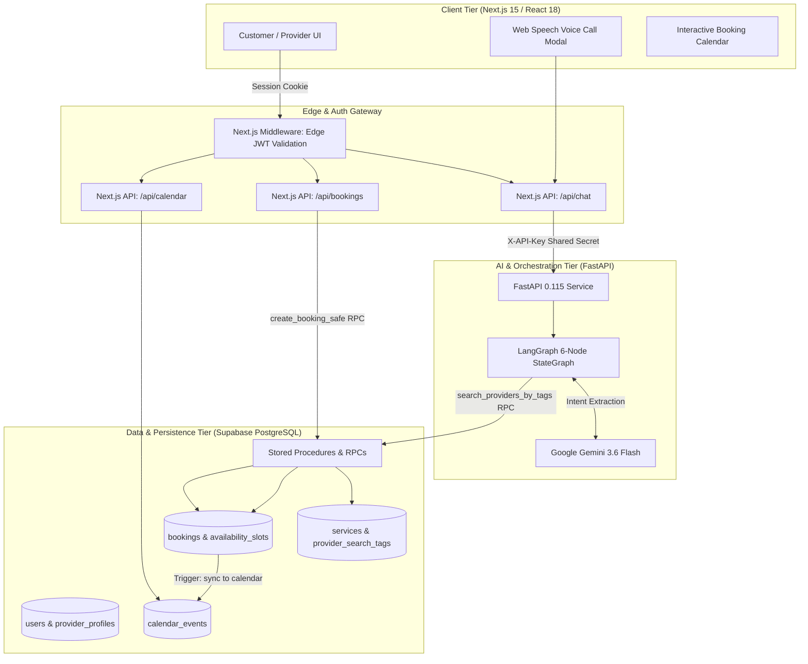
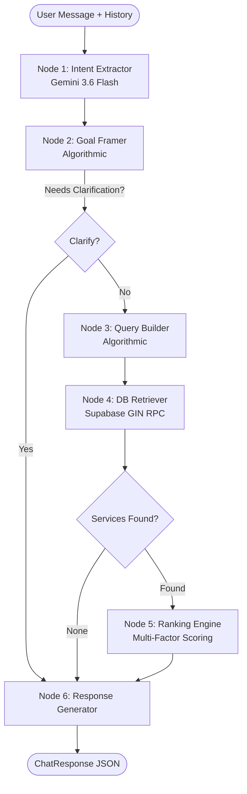
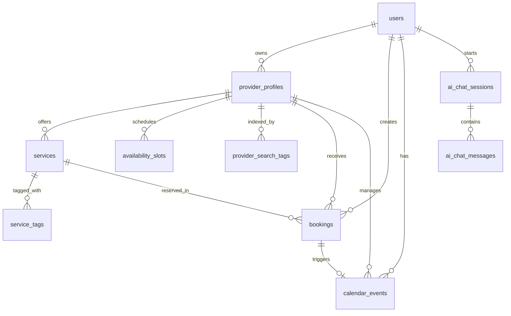
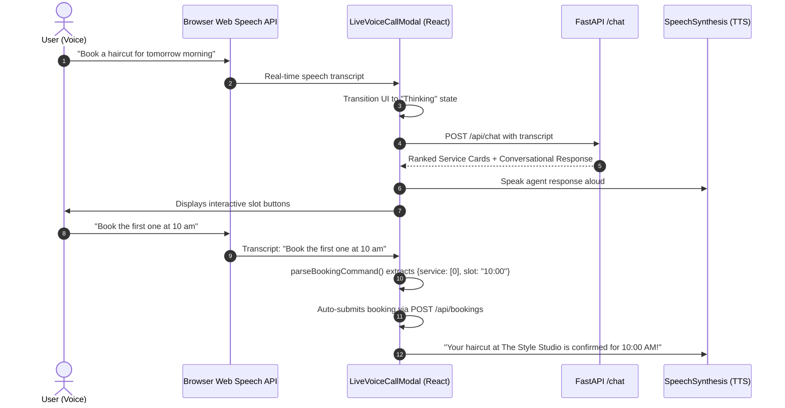

# ScheduleAI (Scheduler AI) — Universal Service Booking Platform

> **Comprehensive Technical Architecture & System Documentation**  
> **Author & Architect:** Mayukh Banerjee  
> **Version:** 2.2.0  
> **Core Stack:** Next.js 15 (App Router) • FastAPI • LangGraph • Google Gemini • Supabase PostgreSQL

---

## Table of Contents
1. [Executive Summary & Core Philosophy](#1-executive-summary--core-philosophy)
2. [High-Level Architecture](#2-high-level-architecture)
3. [The 6-Node LangGraph Agent Pipeline](#3-the-6-node-langgraph-agent-pipeline)
4. [Database Architecture & PostgreSQL RPC Engine](#4-database-architecture--postgresql-rpc-engine)
5. [Anti-Hallucination & Double-Booking Prevention](#5-anti-hallucination--double-booking-prevention)
6. [Dual-Role User & Provider Experience](#6-dual-role-user--provider-experience)
7. [Voice AI & Web Speech Integration](#7-voice-ai--web-speech-integration)
8. [API Specifications & Inter-Service Security](#8-api-specifications--inter-service-security)
9. [Project Directory & File Structure](#9-project-directory--file-structure)
10. [Local Development, Seeding & Deployment](#10-local-development-seeding--deployment)

---

## 1. Executive Summary & Core Philosophy

**ScheduleAI (Scheduler AI)** is an enterprise-grade, full-stack conversational booking platform. It enables customers to discover, evaluate, and instantly reserve verified appointments across a wide range of local service categories (Hair & Beauty, Healthcare, Dental, Legal, Wellness & Spa, Fitness, Education, Consulting, and Home Services) through natural language and interactive voice.

### The Problem It Solves
Traditional appointment scheduling platforms are plagued by two opposing extremes:
1. **Rigid GUI Platforms:** Burden users with multi-step forms, rigid category drop-downs, date pickers, and endless back-and-forth calendar browsing.
2. **Naive AI Chatbots:** Large Language Models (LLMs) instructed with broad prompts frequently **hallucinate available slots**, invent fake pricing, book non-existent dates, or fail under concurrent booking traffic.

### The Core Architectural Philosophy: "AI at the Boundaries"
ScheduleAI strictly isolates artificial intelligence to the communication boundaries:
* **LLM Ingestion (Node 1):** Translates messy, unstructured human speech or text into typed, validated JSON intent representations.
* **Deterministic Core (Nodes 2–5):** Goal validation, synonym expansion, GIN-indexed database scanning, availability filtering, and ranking run entirely on **deterministic Python algorithms** and **PostgreSQL relational operations**. Zero LLM tokens are expended here.
* **LLM / Deterministic Generation (Node 6):** Translates mathematically ranked candidate slots into warm, natural conversational dialog alongside interactive booking cards.

```
┌─────────────────────────────────────────────────────────────────────────────────┐
│                              HUMAN USER (Text or Voice)                         │
└────────────────────────────────────────┬────────────────────────────────────────┘
                                         │ Unstructured Natural Language
                                         ▼
                 ┌───────────────────────────────────────────────┐
                 │       AI BOUNDARY: Node 1 (Intent Extractor)  │
                 │             Google Gemini Flash 3.6           │
                 └───────────────────────┬───────────────────────┘
                                         │ Typed, Structured Intent JSON
                                         ▼
  ╔═════════════════════════════════════════════════════════════════════════════╗
  ║                        DETERMINISTIC COMPUTATIONAL CORE                     ║
  ║                                                                             ║
  ║  [Node 2: Goal Framer] ──> Categorization & Priority Weighting              ║
  ║  [Node 3: Query Builder] ──> Tag Explosion & Synonym Extraction             ║
  ║  [Node 4: DB Retriever] ──> Supabase PostgreSQL GIN Index Scan & Overrides  ║
  ║  [Node 5: Ranking Engine] ──> Algorithmic Multi-Factor Scoring Engine       ║
  ║                                                                             ║
  ╚══════════════════════════════════════┬══════════════════════════════════════╝
                                         │ Mathematically Ranked Verified Slots
                                         ▼
                 ┌───────────────────────────────────────────────┐
                 │    HYBRID/DETERMINISTIC: Node 6 (Response)    │
                 │      Zero-Latency Phrasing & Service Cards    │
                 └───────────────────────┬───────────────────────┘
                                         │
                                         ▼
┌─────────────────────────────────────────────────────────────────────────────────┐
│                     FRONTEND: Verified Service Cards & 1-Click Bookings         │
└─────────────────────────────────────────────────────────────────────────────────┘
```

This guarantees **zero hallucinated slots**, **instant retrieval latency (< 1s)**, **drastically reduced API token costs**, and **provably conflict-free bookings**.

---

## 2. High-Level Architecture

The system is organized as a decoupled, multi-tier distributed architecture:



### Component Roles & Responsibilities

| Tier | Component | Technology | Primary Purpose |
|---|---|---|---|
| **Frontend** | Application Core | [Next.js 15](file:///c:/Mayukh%20Main/Scheduler%20AI/Scheduler-AI/package.json) App Router | Responsive UI, SSR, dynamic routing, Shadcn UI components, Framer Motion animations. |
| **Edge Gateway** | Middleware | [middleware.ts](file:///c:/Mayukh%20Main/Scheduler%20AI/Scheduler-AI/middleware.ts) | Edge-compatible session validation, role enforcement (`customer` vs `provider`), redirect routing. |
| **Backend** | Agent Engine | [FastAPI](file:///c:/Mayukh%20Main/Scheduler%20AI/Scheduler-AI/backend/main.py) + [LangGraph](file:///c:/Mayukh%20Main/Scheduler%20AI/Scheduler-AI/backend/agent.py) | Orchestrates the 6-node state graph, handles query expansions, parses multi-turn dialogue. |
| **AI LLM** | Intent Engine | Google Gemini 3.6 Flash | Extracts structured booking intents, handles slot refinement vs. topic switches. |
| **Database** | Relational & Index Storage | Supabase PostgreSQL | Normalized data tables, GIN index search tags, `btree_gist` constraint checks, auto-sync triggers. |

---

## 3. The 6-Node LangGraph Agent Pipeline

The core AI engine resides in [backend/agent.py](file:///c:/Mayukh%20Main/Scheduler%20AI/Scheduler-AI/backend/agent.py). It uses a compiled LangGraph `StateGraph` with a defined `AgentState` schema:

```python
class AgentState(TypedDict):
    user_message: str
    user_id: str
    conversation_id: str
    history: List[Dict[str, str]]
    intent: Optional[Dict[str, Any]]
    goal_frame: Optional[Dict[str, Any]]
    db_query: Optional[Dict[str, Any]]
    raw_services: Optional[List[Dict]]
    raw_providers: Optional[List[Dict]]
    availability_map: Optional[Dict[str, List[str]]]
    date_map: Optional[Dict[str, str]]
    ranked_results: Optional[List[Dict]]
    response: Optional[str]
    needs_clarification: bool
    clarification_question: Optional[str]
```



### Detailed Breakdown of Each Node

#### Node 1: Intent Extractor (`node_intent_extractor`)
* **AI Dependency:** HIGH (Google Gemini 3.6 Flash via `ChatGoogleGenerativeAI`).
* **Input:** Current message + up to last 8 conversation turns.
* **Responsibilities:**
  * **Slot Refinement vs. Topic Switching:** If Turn 1 is *"I need a dentist"* and Turn 2 is *"tomorrow at 3pm"*, it preserves the service domain and populates the date/time. If Turn 2 switches to *"what about a lawyer?"*, it completely resets the previous domain and removes sticky location constraints.
  * **Relative Date Resolution:** Converts expressions like *"tomorrow"*, *"this Friday"*, or *"next Monday"* into precise ISO dates (`YYYY-MM-DD`) relative to server `today`.
  * **Pydantic Validation:** Maps into strict `ExtractedIntent` model (`service_type`, `specific_service`, `provider_name`, `date`, `time`, `urgency`, `location`).

#### Node 2: Goal Framer (`node_goal_framer`)
* **AI Dependency:** NONE (Algorithmic).
* **Responsibilities:**
  * Validates completeness. If the request lacks a recognizable service domain or intent, it immediately flags `needs_clarification = True` and sets a targeted question.
  * Maps free text to 9 standard domains using `infer_category()`: `Beauty & Hair`, `Healthcare`, `Wellness & Spa`, `Fitness`, `Dental`, `Legal`, `Consulting`, `Education`, and `Home Services`.
  * Sets ranking weights based on urgency:
    * `urgent` $\rightarrow$ `["earliest_slot", "availability", "rating"]`
    * `soon` $\rightarrow$ `["availability", "rating", "price"]`
    * `flexible` $\rightarrow$ `["rating", "availability", "price"]`

#### Node 3: Query Builder (`node_query_builder`)
* **AI Dependency:** NONE (Algorithmic).
* **Responsibilities:**
  * Bypasses slow LLM prompt translation by using `extract_search_tags()` from [backend/matching.py](file:///c:/Mayukh%20Main/Scheduler%20AI/Scheduler-AI/backend/matching.py).
  * Expands intent keywords into comprehensive synonyms (e.g., *"teeth cleaning"* expands to `["cleaning", "cavity", "dental", "dentist", "scaling", "teeth", "tooth"]`).
  * Generates clean filter parameters for the PostgreSQL GIN index scan.

#### Node 4: DB Retriever (`node_db_retriever`)
* **AI Dependency:** NONE (Algorithmic + Relational RPC).
* **Responsibilities:**
  * Invokes the PostgreSQL stored procedure `search_providers_by_tags()` with a 3-tier fallback strategy:
    1. **Tier 1:** Strict tags + category + user location.
    2. **Tier 2 (City-wide fallback):** If 0 results, drops the neighborhood restriction.
    3. **Tier 3 (Category fallback):** If still 0 results, pulls top-rated providers in that domain.
  * Queries real working hours from `availability_slots`.
  * Evaluates date overrides against recurring weekday templates using `filter_by_availability()`. Providers with zero matching slots on the requested date are pruned.

#### Node 5: Ranking Engine (`node_ranking_engine`)
* **AI Dependency:** NONE (Mathematical Scoring).
* **Responsibilities:**
  * Implements multi-factor weighted scoring:
    $$Score = \text{ProviderMatchBonus}(+10) + \sum (\text{PriorityWeight}_i \times \text{FactorValue}_i) + \text{Rating} + (0.25 \times \min(\text{SlotCount}, 5))$$
  * Factors include provider name preference, customer rating (1.0–5.0), open slot abundance, slot proximity to preferred time, and pricing competitiveness.
  * Orders candidates descendingly and returns the top 3–5 best matches.

#### Node 6: Response Generator (`node_response_generator`)
* **AI Dependency:** Deterministic (0 extra LLM calls).
* **Responsibilities:**
  * Directly constructs an instant, friendly, conversational reply incorporating the top provider's name, verified location, and requested date.
  * Attaches structured `services` payloads containing provider IDs, prices, duration, descriptions, and verified time buttons.
  * Delivers sub-second responses without risking LLM downtime, rate-limiting, or token exhaustion.

---

## 4. Database Architecture & PostgreSQL RPC Engine

ScheduleAI runs on a normalized **Supabase PostgreSQL** instance with high-performance indexes and custom stored procedures.



### Table Definitions & Roles

| Table Name | Primary Keys & References | Core Attributes & Indexing | Purpose |
|---|---|---|---|
| `users` | `id UUID PK` | `email UNIQUE`, `password_hash`, `role` (`customer` \| `provider`) | Core authentication and identity record. |
| `provider_profiles` | `id UUID PK`, `user_id FK` | `business_name`, `category`, `location`, `rating`, `total_reviews`, `is_verified` | Provider directory profile and business metadata. |
| `services` | `id UUID PK`, `provider_id FK` | `name`, `price`, `duration_minutes`, `is_active`, `sort_order`, `legacy_id` | Catalog of individual bookable offerings. |
| `service_tags` | `id UUID PK`, `service_id FK` | `tag TEXT` | Granular keyword tags for individual services. |
| `provider_search_tags` | `id UUID PK`, `provider_id FK` | `tag TEXT`, indexed with **PostgreSQL GIN** | Aggregated search tags across business and services for fast sub-millisecond retrieval. |
| `availability_slots` | `id UUID PK`, `provider_id FK` | `day_of_week`, `specific_date`, `start_time`, `is_booked` | Provider operational calendar templates and date overrides. |
| `bookings` | `id UUID PK`, `user_id FK`, `provider_id FK`, `service_id FK` | `date DATE`, `start_time TIME`, `end_time TIME GENERATED`, `status`, `price` | Confirmed customer appointments with conflict protection. |
| `calendar_events` | `id UUID PK`, `user_id FK`, `provider_id FK`, `booking_id FK` | `start_at TIMESTAMPTZ`, `end_at TIMESTAMPTZ`, `event_type`, `source` | Internal calendar representation for users and providers. |
| `ai_chat_sessions` | `id UUID PK`, `user_id FK` | `conversation_id UNIQUE`, `total_messages`, `last_active_at` | Tracks multi-turn conversational threads. |
| `ai_chat_messages` | `id UUID PK`, `session_id FK` | `turn_index`, `role`, `content`, `services JSONB` | Message logs for session hydration across page reloads. |

---

## 5. Anti-Hallucination & Double-Booking Prevention

ScheduleAI implements multi-layered concurrency controls that make double-booking mathematically impossible.

### 1. Partial Unique Index (Exact Match Block)
In [migrations/005_bookings.sql](file:///c:/Mayukh%20Main/Scheduler%20AI/Scheduler-AI/migrations/005_bookings.sql):
```sql
CREATE UNIQUE INDEX IF NOT EXISTS unique_active_provider_slot
  ON bookings(provider_id, date, start_time)
  WHERE status IN ('confirmed', 'pending', 'completed');
```
Prevents two active bookings from being placed for the exact same provider, date, and start time.

### 2. Range-Based Exclusion Constraint (`btree_gist`)
Exact time indexing is insufficient if appointments have variable durations (e.g., a 90-minute haircut starting at 10:00 AM overlaps with an appointment scheduled for 10:30 AM). ScheduleAI utilizes PostgreSQL `tsrange` with `btree_gist`:
```sql
ALTER TABLE bookings ADD CONSTRAINT no_overlapping_bookings
  EXCLUDE USING GIST (
    provider_id     WITH =,
    date            WITH =,
    tsrange(
      date + start_time,
      date + end_time,
      '[)'
    )               WITH &&
  )
  WHERE (status IN ('confirmed', 'pending', 'completed'));
```
The operator `&&` detects range overlap between $[start\_time, end\_time)$. Even during high-frequency concurrent API calls, PostgreSQL will reject any overlapping booking at the storage engine level.

### 3. Atomic Booking RPC (`create_booking_safe`)
Booking creation is wrapped in an atomic stored procedure in [migrations/010_functions.sql](file:///c:/Mayukh%20Main/Scheduler%20AI/Scheduler-AI/migrations/010_functions.sql):
1. Verifies that the slot is unbooked.
2. Inserts the booking record.
3. Automatically sets `is_booked = TRUE` in `availability_slots` for either the specific date override or the recurring weekday schedule.
4. If a conflict occurs, it raises exception `SLOT_TAKEN` (`P0001`), returning an HTTP 409 conflict to the client.

### 4. Automatic Calendar Synchronization Trigger
When a booking is confirmed, an automatic PostgreSQL database trigger (`booking_to_calendar_event`) executes:
```sql
CREATE TRIGGER booking_to_calendar_event
  AFTER INSERT OR UPDATE OF status ON bookings
  FOR EACH ROW EXECUTE FUNCTION create_calendar_event_from_booking();
```
* **On Insert/Confirm:** Automatically creates synchronized `calendar_events` for both the customer and the provider.
* **On Cancellation:** Automatically removes or flags the calendar event and marks the slot in `availability_slots` as `is_booked = FALSE`.

---

## 6. Dual-Role User & Provider Experience

ScheduleAI provides two specialized dashboard workspaces separated by role-based routing.

```
                    ┌─────────────────────────┐
                    │    /login or /signup    │
                    └────────────┬────────────┘
                                 │
                     [Role in Signed JWT]
                                 │
             ┌───────────────────┴───────────────────┐
             │                                       │
     role: "user"                            role: "provider"
             ▼                                       ▼
 ┌───────────────────────┐               ┌───────────────────────┐
 │    CUSTOMER PORTAL    │               │    PROVIDER PORTAL    │
 │    /dashboard/user    │               │   /dashboard/client   │
 └───────────────────────┘               └───────────────────────┘
```

### Customer Portal (`/dashboard/user`)
* **AI Scheduler View (`/dashboard/user`):** Real-time chat with the LangGraph agent, speech-to-text mic input, one-click slot booking, and a compact calendar sidebar widget.
* **Discover View (`/dashboard/user/discover`):** Explore service categories, filter by keyword, inspect provider ratings, reviews, and detailed pricing catalogs.
* **Bookings View (`/dashboard/user/bookings`):** Comprehensive list of upcoming, completed, and cancelled bookings with one-click cancellation.
* **Calendar View (`/dashboard/user/calendar`):** Full-screen interactive weekly calendar showing confirmed appointments.
* **Analytics View (`/dashboard/user/analytics`):** Powered by Recharts and the `get_user_analytics` PostgreSQL function:
  * **Minutes Saved:** Estimates personal time saved ($30 \text{ mins} \times \text{completed bookings}$).
  * **Spending Breakdown:** Total capital invested by service category.
  * **Completion Rate:** Statistical ratio of kept appointments vs. cancellations.
  * **Monthly Trend Analysis:** Appointment volume over the prior 6 months.

### Provider Portal (`/dashboard/client`)
* **Booking Operations:** Interactive day, week, and month calendars with visual color-coded badges for Confirmed, Pending, Completed, and Cancelled appointments.
* **Appointment Lifecycle Controls:** Modals allowing providers to mark sessions as completed, approve pending requests, or cancel appointments.
* **Service Catalog Management:** Add, edit, or disable specific services, modify prices, duration in minutes, and search tags.
* **Availability Overrides:** Set standard weekly working hours or apply **specific date overrides** (e.g., mark a holiday, adjust hours on a specific Monday, or add emergency weekend slots).

---

## 7. Voice AI & Web Speech Integration

ScheduleAI features a voice-first interface implemented in [components/dashboard/user/live-voice-call-modal.tsx](file:///c:/Mayukh%20Main/Scheduler%20AI/Scheduler-AI/components/dashboard/user/live-voice-call-modal.tsx) and [components/dashboard/user/chat-interface.tsx](file:///c:/Mayukh%20Main/Scheduler%20AI/Scheduler-AI/components/dashboard/user/chat-interface.tsx).



### Key Technical Aspects of Voice Mode
1. **Client-Side STT:** Employs the native browser **Web Speech API** (`SpeechRecognition` / `webkitSpeechRecognition`), requiring zero server-side speech-to-text proxying and eliminating audio stream latency.
2. **AI Phase State Machine:** Visual indicators shift between `listening`, `thinking`, `processing`, and `generating` states with animated waveforms.
3. **Voice Command Parser (`parseBookingCommand`):**
   * **Ordinal Selections:** Recognizes words like *"first"*, *"second"*, *"1st"*, *"2nd"*.
   * **Time Matches:** Matches natural times (*"at 10"*, *"11:30 am"*, *"2 pm"*).
   * **Confirmation Triggers:** Recognizes intent triggers (*"confirm"*, *"book it"*, *"sounds good"*, *"go ahead"*).
4. **Hands-Free Speech Synthesis (TTS):** Uses the browser's `SpeechSynthesisUtterance` to read out assistant recommendations naturally.

---

## 8. API Specifications & Inter-Service Security

### Inter-Service Authentication Flow
1. **Client $\rightarrow$ Next.js:** Requests carry an HTTP-only cookie `auth_token` verified by [lib/auth-edge.ts](file:///c:/Mayukh%20Main/Scheduler%20AI/Scheduler-AI/lib/auth-edge.ts) using the shared `JWT_SECRET`.
2. **Next.js $\rightarrow$ FastAPI:** Server-to-server calls include the custom header `X-API-Key: BACKEND_API_KEY`. Unauthenticated requests to `/chat` receive an immediate `401 Unauthorized`.

```
Client (Browser) 
      │
      │  Cookie: auth_token (HS256 JWT)
      ▼
Next.js App Router API Route (/api/chat)
      │
      │  Header: X-API-Key: <BACKEND_API_KEY>
      ▼
FastAPI Backend (/chat)
```

### Core API Endpoints

#### 1. `POST /api/chat` (Next.js Gateway) & `POST /chat` (FastAPI)
* **Description:** Primary conversational booking gateway. Runs the 6-node LangGraph pipeline.
* **Request Body:**
```json
{
  "message": "I need a dentist tomorrow afternoon in Indiranagar",
  "conversation_id": "conv-1718293021",
  "messages": [
    { "role": "user", "content": "Hi there" },
    { "role": "assistant", "content": "Hello! What service can I help you book today?" }
  ]
}
```
* **Response Body:**
```json
{
  "reply": "I found top-rated dentists in Indiranagar for tomorrow! Here are verified slots with City Dental Clinic. Tap any slot to confirm:",
  "needs_clarification": false,
  "clarification_question": null,
  "intent": {
    "service_type": "dentist",
    "specific_service": "dental checkup",
    "date": "2026-10-14",
    "time": "afternoon",
    "location": "Indiranagar"
  },
  "services": [
    {
      "service_id": "d0000000-0000-0000-0000-000000000003",
      "service_name": "Comprehensive Dental Checkup",
      "category": "Dental",
      "provider_id": "c0000000-0000-0000-0000-000000000002",
      "provider_name": "City Dental Clinic",
      "provider_email": "citydentalclinic@demo.com",
      "location": "Indiranagar, Bangalore",
      "price": 500.0,
      "duration_minutes": 45,
      "available_slots": ["14:00", "15:30", "16:30"],
      "rating": 4.8,
      "date": "2026-10-14"
    }
  ]
}
```

#### 2. `POST /api/bookings`
* **Description:** Atomically commits a customer reservation.
* **Request Body:**
```json
{
  "service_id": "d0000000-0000-0000-0000-000000000003",
  "provider_id": "c0000000-0000-0000-0000-000000000002",
  "date": "2026-10-14",
  "time": "14:00",
  "service_name": "Comprehensive Dental Checkup",
  "duration_minutes": 45
}
```
* **Status Codes:**
  * `200 OK`: Booking created, slot locked, calendar event synchronized.
  * `400 Bad Request`: Invalid parameters or improper date formatting.
  * `409 Conflict`: Slot already reserved by a concurrent user (`SLOT_TAKEN`).

#### 3. `GET /api/calendar/user` & `GET /api/calendar/provider`
* **Description:** Retrieves internal calendar events for personal or provider schedule views.

#### 4. `POST /api/auth/register` & `POST /api/auth/login`
* **Description:** Handles dual-role account registration and authentication, setting an HTTP-only JWT cookie.

---

## 9. Project Directory & File Structure

```
Scheduler-AI/
├── AGENT.md                       # Comprehensive architecture and technical documentation
├── README.md                      # Quickstart guide & repository overview
├── DEPLOY.md                      # Production deployment guidelines
├── DEMO.md                        # Step-by-step viva & demonstration script
├── middleware.ts                  # Edge runtime JWT validation & dashboard route guarding
├── package.json                   # Next.js 15, Tailwind, Lucide, Recharts dependencies
├── start_servers.ps1              # Unified PowerShell startup script for frontend & backend
│
├── app/                           # Next.js App Router
│   ├── page.tsx                   # Marketing landing page (Hero, Features, Preview)
│   ├── layout.tsx                 # Root HTML layout with theme providers & toast container
│   ├── login/                     # Dual-role authentication page
│   ├── signup/                    # Dual-role registration page
│   ├── dashboard/
│   │   ├── page.tsx               # Role-based dashboard dispatcher (/user vs /client)
│   │   ├── user/                  # Customer Dashboard
│   │   │   ├── page.tsx           # AI Scheduler page with chat & voice modal
│   │   │   ├── layout.tsx         # Customer shell layout (Sidebar + Header)
│   │   │   ├── discover/          # Browse catalog of service providers
│   │   │   ├── bookings/          # My Bookings list & cancellation management
│   │   │   ├── calendar/          # Weekly customer booking calendar
│   │   │   └── analytics/         # Recharts visual spending & time-saved analytics
│   │   └── client/                # Provider Dashboard
│   │       └── page.tsx           # Business calendar, slot override & service manager
│   └── api/                       # Next.js API Routes (Server runtime)
│       ├── auth/                  # Login, register, logout, me
│       ├── chat/                  # Bridge to FastAPI backend + message persistence
│       ├── bookings/              # Atomic booking creation & cancellation
│       ├── calendar/              # Calendar events retrieval
│       └── provider/              # Provider profile & availability management
│
├── backend/                       # Python FastAPI Backend
│   ├── main.py                    # ASGI app, CORS configuration, /chat endpoint
│   ├── agent.py                   # 6-node LangGraph StateGraph agent definition
│   ├── database.py                # Supabase client query methods & GIN RPC caller
│   ├── matching.py                # Categorization, search tags, availability & ranking engine
│   ├── models.py                  # Pydantic models for intent, requests, and responses
│   ├── seed_db.py                 # Database seeding script with realistic demo data
│   ├── requirements.txt           # Python packages: fastapi, langgraph, langchain-google-genai
│   └── .env.example               # Backend environment variables template
│
├── components/                    # React UI Components
│   ├── booking-calendar.tsx       # Reusable interactive calendar component
│   ├── auth-modal.tsx             # Dual-role popup login/signup modal
│   ├── dashboard/user/            # Customer dashboard modular components
│   │   ├── chat-interface.tsx     # Message thread, input bar, mic controls
│   │   ├── live-voice-call-modal  # Fullscreen voice call AI assistant modal
│   │   ├── service-card.tsx       # Interactive card displaying provider slots
│   │   ├── sidebar.tsx            # Collapsible navigation sidebar
│   │   ├── header.tsx             # Breadcrumbs, user profile, theme toggle
│   │   └── types.ts               # TypeScript interfaces for chat and bookings
│   └── landing/                   # Landing page sections (hero, features, navbar, footer)
│
├── lib/                           # Shared Utilities
│   ├── auth.ts                    # Server-side auth utilities (bcrypt, cookies)
│   ├── auth-edge.ts               # Edge-safe JWT signing and verification (jose)
│   ├── supabase.ts                # Supabase anon client & service role admin client
│   └── utils.ts                   # CSS clsx/tailwind-merge helper
│
└── migrations/                    # PostgreSQL Schema Migrations
    ├── 000_full_schema.sql        # Complete consolidated database schema
    ├── 001_enable_extensions.sql  # uuid-ossp and btree_gist extensions
    ├── 002_users_and_auth.sql     # users table and auth schemas
    ├── 003_provider_profiles.sql  # provider_profiles and availability_slots
    ├── 004_services.sql           # services, service_tags, provider_search_tags
    ├── 005_bookings.sql           # bookings, GIST range exclusion constraint
    ├── 006_calendar_events.sql    # calendar_events & auto-sync database triggers
    ├── 007_ai_chat.sql            # ai_chat_sessions & ai_chat_messages
    ├── 008_reviews.sql            # reviews table
    ├── 009_indexes_and_views.sql  # GIN indexes, composite indexes, view definitions
    └── 010_functions.sql          # search_providers_by_tags, create_booking_safe, etc.
```

---

## 10. Local Development, Seeding & Deployment

### 1. Prerequisites
* **Node.js:** v18.18+ or v20+
* **Python:** 3.10+ or 3.11+
* **Supabase Project:** Active Supabase project with database access
* **Google Gemini API Key:** For conversational intent extraction

### 2. Environment Configuration

**Root `.env.local`** (Next.js):
```env
NEXT_PUBLIC_SUPABASE_URL=https://your-project.supabase.co
NEXT_PUBLIC_SUPABASE_ANON_KEY=your-anon-key-here
SUPABASE_SERVICE_ROLE_KEY=your-service-role-key-here
JWT_SECRET=super-secret-random-jwt-key
BACKEND_URL=http://localhost:8000
NEXT_PUBLIC_BACKEND_URL=http://localhost:8000
BACKEND_API_KEY=shared-secret-key-between-next-and-fastapi
```

**`backend/.env`** (FastAPI):
```env
GEMINI_API_KEY=your-google-gemini-api-key
GEMINI_MODEL=gemini-3.6-flash
SUPABASE_URL=https://your-project.supabase.co
SUPABASE_SERVICE_ROLE_KEY=your-service-role-key-here
BACKEND_API_KEY=shared-secret-key-between-next-and-fastapi
CORS_ORIGINS=http://localhost:3000,http://127.0.0.1:3000
```

> [!IMPORTANT]
> `BACKEND_API_KEY` must match exactly in both `.env.local` and `backend/.env`.

### 3. Installation & Database Seeding

```powershell
# 1. Install frontend dependencies
npm install

# 2. Set up Python backend virtual environment
cd backend
python -m venv venv
.\venv\Scripts\activate      # Windows (or source venv/bin/activate on Unix)
pip install -r requirements.txt

# 3. Seed Supabase PostgreSQL with demo providers and users
python seed_db.py
cd ..
```

### 4. Running the Development Servers
From the repository root, start both servers concurrently:
```powershell
.\start_servers.ps1
```
* **Frontend:** [http://localhost:3000](http://localhost:3000)
* **Backend API:** [http://localhost:8000](http://localhost:8000)
* **Interactive OpenAPI Docs:** [http://localhost:8000/docs](http://localhost:8000/docs)

### 5. Demo Accounts

| Role | Email | Password | Details |
|---|---|---|---|
| **Customer** | `demo@scheduleai.com` | `demo1234` | Full customer dashboard with active booking history. |
| **Provider (Salon)** | `thestylestudio@demo.com` | `demo1234` | The Style Studio (Haircut, Coloring) in Bangalore. |
| **Provider (Dental)** | `citydentalclinic@demo.com` | `demo1234` | City Dental Clinic (Checkup, Scaling, Whitening). |
| **Provider (Legal)** | `vanguardlegal@demo.com` | `demo1234` | Vanguard Legal Advisory (Consultation, Trademark). |

---

*ScheduleAI is designed, developed, and maintained by [Mayukh Banerjee](https://github.com/MayukhBanerjee).*
