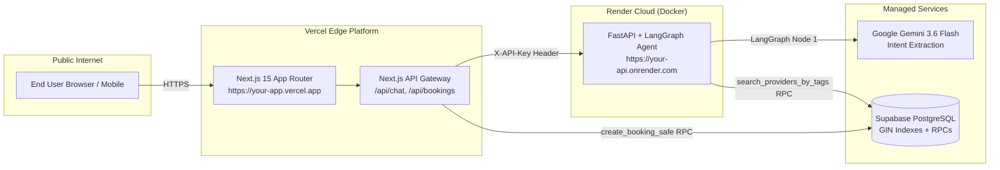

# ScheduleAI — Production Deployment Guide

This guide provides a complete, step-by-step walkthrough to publicly deploy ScheduleAI across **Render (FastAPI + Docker backend)** and **Vercel (Next.js 15 frontend)**, connected to **Supabase PostgreSQL**.

---

## Architecture Overview



---

## Prerequisites Checklist

Before you begin, make sure you have:
1. **GitHub Repository:** Your code committed and pushed to a GitHub repository (public or private).
2. **Supabase Account:** Project created at [supabase.com](https://supabase.com).
3. **Google AI Studio Account:** API Key obtained from [aistudio.google.com](https://aistudio.google.com).
4. **Render Account:** Signed up at [render.com](https://render.com).
5. **Vercel Account:** Signed up at [vercel.com](https://vercel.com).
6. **Shared Backend Secret:** Generate a long, random key for `BACKEND_API_KEY` (e.g. `openssl rand -hex 32` or any 32+ character random string).

---

## Step 1: Set Up Supabase PostgreSQL

If you haven't set up your Supabase database yet:

1. Log in to [Supabase Dashboard](https://supabase.com/dashboard) and open your project.
2. Go to the **SQL Editor** in the left sidebar.
3. Run the migrations in order from the `migrations/` directory:
   - Either paste and execute `migrations/000_full_schema.sql` (consolidated schema).
   - Or run files sequentially:
     - `migrations/001_enable_extensions.sql` (UUID and `btree_gist`)
     - `migrations/002_users_and_auth.sql`
     - `migrations/003_provider_profiles.sql`
     - `migrations/004_services.sql`
     - `migrations/005_bookings.sql`
     - `migrations/006_calendar_events.sql`
     - `migrations/007_ai_chat.sql`
     - `migrations/008_reviews.sql`
     - `migrations/009_indexes_and_views.sql`
     - `migrations/010_functions.sql` (RPC functions `search_providers_by_tags`, `create_booking_safe`, etc.)
     - `migrations/011_seed_data.sql` (demo providers, services, and accounts)
4. Go to **Project Settings** $\rightarrow$ **API** and copy:
   - **Project URL** (`https://xyz.supabase.co`)
   - **anon / public key**
   - **service_role secret key** (Reveal and copy)

---

## Step 2: Deploy Backend to Render (Docker)

You can deploy the backend using either **Method A (Render Blueprint)** or **Method B (Manual Web Service)**.

### Method A: Automated Deployment via Blueprint (`render.yaml`)

1. Ensure [render.yaml](file:///c:/Mayukh%20Main/Scheduler%20AI/Scheduler-AI/render.yaml) is committed to your GitHub repository root.
2. In the [Render Dashboard](https://dashboard.render.com), click **New +** $\rightarrow$ **Blueprint**.
3. Connect your GitHub repository.
4. Render will read `render.yaml` and create the `scheduleai-backend` web service.
5. In the prompts, fill in the environment variables marked `sync: false` (see variable table below).
6. Click **Apply**.

---

### Method B: Manual Web Service Setup on Render

1. In the [Render Dashboard](https://dashboard.render.com), click **New +** $\rightarrow$ **Web Service**.
2. Select **Build and deploy from a Git repository** and connect your GitHub repo.
3. Configure the service settings:
   - **Name:** `scheduleai-backend` (or your preferred name)
   - **Region:** Choose the region closest to you (e.g. `Oregon (US West)` or `Frankfurt (EU)`)
   - **Branch:** `main` (or your default branch)
   - **Root Directory:** Leave blank (or specify `backend` if you prefer, but root is standard)
   - **Runtime:** **Docker**
   - **Dockerfile Path:** `backend/Dockerfile`
   - **Docker Context:** `backend`
   - **Instance Type:** **Free** (or Starter/Standard for zero cold starts)
4. Scroll down to **Environment Variables** and click **Add Environment Variable**:

| Variable Key | Value / Instructions | Example |
|---|---|---|
| `GEMINI_API_KEY` | Your Google Gemini API Key | `AIzaSy...` |
| `GEMINI_MODEL` | Preferred Gemini model | `gemini-3.6-flash` |
| `SUPABASE_URL` | Your Supabase Project URL | `https://xxxx.supabase.co` |
| `SUPABASE_SERVICE_ROLE_KEY` | Supabase `service_role` secret | `eyJhbGci...` |
| `BACKEND_API_KEY` | Shared secret key for API authentication | `my-secret-token-12345` |
| `CORS_ORIGINS` | Allowed origins (set to `*` initially, then restrict to your Vercel URL) | `*` |

5. Scroll down to **Health Check Path** and set it to:
   ```
   /
   ```
6. Click **Create Web Service**.

---

### Verify the Render Backend Deployment

Render will build the Docker container and start Uvicorn. Once the deployment status turns **Live**:

1. Note your Render URL:  
   `https://scheduleai-backend.onrender.com` (example)
2. Test the health endpoint in your browser or with curl:
   ```bash
   curl https://scheduleai-backend.onrender.com/
   ```
   Expected response:
   ```json
   {
     "status": "ok",
     "service": "ScheduleAI Universal Booking API",
     "database": "Supabase PostgreSQL",
     "version": "2.2.0"
   }
   ```
3. Test OpenAPI interactive documentation:
   Open `https://scheduleai-backend.onrender.com/docs` in your browser.
4. Test API Key verification:
   ```bash
   curl -X POST https://scheduleai-backend.onrender.com/chat -H "Content-Type: application/json" -d '{"message":"test", "user_id":"anon"}'
   ```
   Should return `401 Unauthorized` (confirming `X-API-Key` security is working).

---

## Step 3: Deploy Frontend to Vercel

1. Log in to [Vercel Dashboard](https://vercel.com/dashboard) and click **Add New...** $\rightarrow$ **Project**.
2. Import your GitHub repository.
3. Configure project settings:
   - **Framework Preset:** `Next.js`
   - **Root Directory:** `./` (leave default)
   - **Build Command:** `npm run build` (leave default)
   - **Output Directory:** `.next` (leave default)
   - **Install Command:** `npm install` (leave default)
4. Expand **Environment Variables** and add the following:

| Variable Key | Value / Instructions |
|---|---|
| `NEXT_PUBLIC_SUPABASE_URL` | Your Supabase Project URL (`https://xxxx.supabase.co`) |
| `NEXT_PUBLIC_SUPABASE_ANON_KEY` | Your Supabase `anon` public key |
| `SUPABASE_SERVICE_ROLE_KEY` | Your Supabase `service_role` secret key |
| `JWT_SECRET` | Strong random secret string for JWT cookie signing |
| `BACKEND_URL` | Your Render URL without trailing slash (e.g. `https://scheduleai-backend.onrender.com`) |
| `NEXT_PUBLIC_BACKEND_URL` | Same Render URL (`https://scheduleai-backend.onrender.com`) |
| `BACKEND_API_KEY` | **Exact same** shared secret string configured in Render |

5. Click **Deploy**.
6. Vercel will install dependencies, build the Next.js production bundle, and assign your public domain:
   `https://your-project.vercel.app`

---

## Step 4: Link & Secure Both Deployments (CORS)

Now that your Vercel frontend has a live production URL:

1. Go back to your [Render Dashboard](https://dashboard.render.com).
2. Select your `scheduleai-backend` service $\rightarrow$ **Environment**.
3. Update the `CORS_ORIGINS` variable:
   ```
   https://your-project.vercel.app
   ```
   *(If you have custom domains or preview deployments, separate them with commas: `https://your-project.vercel.app,https://yourdomain.com`)*
4. Click **Save Changes** (Render will redeploy with updated CORS settings).

---

## Step 5: Acceptance Smoke-Testing

Test the end-to-end integration on your live Vercel URL:

1. **Public Landing Page:**
   - Open `https://your-project.vercel.app`.
   - Verify hero section, animations, and preview modules load without errors.

2. **Customer Authentication:**
   - Click **Log In** $\rightarrow$ use demo account `demo@scheduleai.com` / `demo1234`.
   - Verify you are redirected to `/dashboard/user`.

3. **AI Chat & Slot Retrieval:**
   - In the AI Scheduler, type:  
     `"I need a haircut tomorrow afternoon"`
   - Verify the assistant replies with conversational copy and verified service cards containing time buttons (e.g. `14:00`, `16:00`).

4. **1-Click Booking:**
   - Click one of the time slots.
   - Confirm the booking succeeds and appears in **My Bookings** and the **Calendar** widget.

5. **Double-Booking Prevention:**
   - Attempt to book the same slot again in a separate tab or session.
   - Verify the platform returns a conflict error and refuses the double booking.

6. **Web Speech Audio:**
   - In Chrome or Edge, click the **Mic** button or open the **Live Voice Call** modal.
   - Speak into your microphone and verify speech recognition transcribes your words.

7. **Provider Dashboard:**
   - Log out, then log in as a business provider: `thestylestudio@demo.com` / `demo1234`.
   - Verify you are routed to `/dashboard/client`.
   - Inspect the calendar, verify bookings, and test the status controls.

---

## Troubleshooting & FAQ

### 1. Render Free Tier Cold Starts
* **Symptom:** First chat message after 15 minutes of inactivity takes 30–50 seconds to respond.
* **Explanation:** Render free web services spin down after 15 minutes of inactivity.
* **Remedies:**
  * ScheduleAI's `/api/chat` route has `maxDuration = 60` configured in Next.js to allow up to 60 seconds for cold starts.
  * You can set up a free uptime monitor (e.g., [cron-job.org](https://cron-job.org) or [UptimeRobot](https://uptimerobot.com)) to ping `https://your-api.onrender.com/` every 10 minutes.
  * Alternatively, upgrade Render to the $7/mo Starter plan to keep the instance always warm.

### 2. 401 Unauthorized from `/api/chat`
* **Cause:** `BACKEND_API_KEY` in Vercel does not match `BACKEND_API_KEY` in Render.
* **Fix:** Re-copy the exact key into both dashboards and trigger a redeploy.

### 3. Database Connection Errors
* **Cause:** `SUPABASE_SERVICE_ROLE_KEY` is missing or invalid.
* **Fix:** Ensure the secret key (not the anon key) is provided to `SUPABASE_SERVICE_ROLE_KEY` in both Render and Vercel.

---

*ScheduleAI is built and maintained by [Mayukh Banerjee](https://github.com/MayukhBanerjee).*
